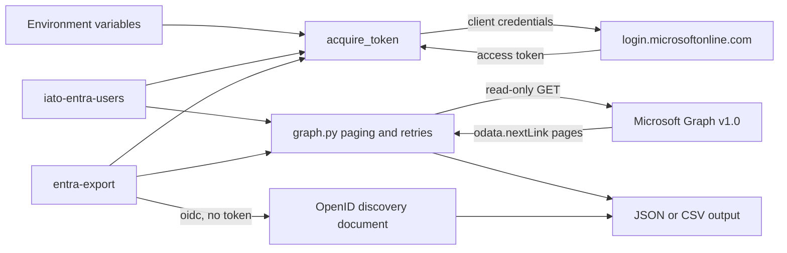

# Read-only Microsoft Entra ID exports with Microsoft Graph

## Summary

This package gives an identity or systems administrator two command-line tools for routine, read-only reporting on a Microsoft Entra ID (Azure AD) tenant through Microsoft Graph. `iato-entra-users` exports every user to JSON or CSV, and `entra-export` exports admin role assignments, groups, group memberships, app registrations, service principals, delegated OAuth 2.0 consents and the tenant's OpenID Connect discovery document. It uses only the Python standard library, follows `@odata.nextLink` paging, retries throttling while honouring `Retry-After`, never sends the token to a host other than Microsoft Graph, and fails closed: a run that cannot read every page writes nothing. It shows careful, least-privilege Graph automation that uses read permissions only.

Status: the unit tests run without a network and pass in CI on Python 3.10 and 3.13. No run against a live tenant is recorded in the repository yet: the screenshots in `docs/screenshots/` are pending a Microsoft 365 developer test tenant.

## Diagram



`iato_bau/graph.py` checks that every URL, including each next link, points at `https://graph.microsoft.com/v1.0/` before the token is attached. The `oidc` export reads the tenant's public discovery document and sends no token.

## How to run

Prerequisites: Python 3.10 or later and git. Live Graph exports also need an app registration with read permissions and admin consent (see [Authentication](#authentication)); the tests and the `oidc` export need no credentials.

1. Clone the repository:

   ```
   git clone https://github.com/dhruv-setty/entra-graph-readonly-exports.git
   cd entra-graph-readonly-exports
   ```

2. Run the unit tests. No network or tenant is needed; the run ends with `OK`.

   ```
   python -m unittest discover -s tests -t . -v
   ```

3. Install the package and check that both commands start. Each prints its usage.

   ```
   pip install .
   iato-entra-users --help
   entra-export --help
   ```

4. Run an export that needs no token, only internet access. This prints `Exported 1 oidc rows at ...` on stderr and one JSON object with the tenant's `issuer`, `authorization_endpoint`, `token_endpoint` and `jwks_uri` on stdout.

   ```
   entra-export oidc --tenant contoso.onmicrosoft.com
   ```

5. For the Graph exports, set `MS_GRAPH_TOKEN`, or `AZURE_TENANT_ID`, `AZURE_CLIENT_ID` and `AZURE_CLIENT_SECRET`, then run, for example:

   ```
   iato-entra-users --format csv --output users.csv
   entra-export roles --format csv --output roles.csv
   ```

   Without these variables the commands stop with `Set MS_GRAPH_TOKEN, or AZURE_TENANT_ID, AZURE_CLIENT_ID and AZURE_CLIENT_SECRET`.

## Contents

- [Tools](#tools): `iato-entra-users` and `entra-export`
- [Authentication](#authentication)
- [Layout](#layout)
- [Tests](#tests)
- [Screenshots](#screenshots)
- [Microsoft Graph references](#microsoft-graph-references)

## Overview

Daily operational tooling for the routine, business-as-usual work an identity or systems administrator runs every day against Microsoft Entra ID (Azure AD) through Microsoft Graph.

## Tools

### `iato-entra-users`

Exports every user in the tenant to JSON or CSV.

- Requests pages of 999, the Graph maximum, and follows `@odata.nextLink` until none is returned, so tenants of any size come back whole.
- Refuses a next link that does not point at `https://graph.microsoft.com/v1.0/`, so the bearer token is never sent anywhere else.
- Retries throttling (429) and server errors, honouring `Retry-After`, capped at 60 seconds.
- Selects the user's address as `mail`. Graph has no `email` property on user.

```
pip install .
iato-entra-users > users.json
iato-entra-users --format csv --output users.csv
iato-entra-users --filter "accountEnabled eq true" --fields id,userPrincipalName,mail,department
```

Default fields: `id`, `userPrincipalName`, `displayName`, `givenName`, `surname`, `mail`, `jobTitle`, `department`, `officeLocation`, `companyName`, `employeeId`, `mobilePhone`, `businessPhones`, `accountEnabled`, `userType`, `createdDateTime`. In CSV, list values such as `businessPhones` are joined with `;`.

### `entra-export`

Read-only exports of the directory around the users: who holds which admin role, which groups exist and who is in them, which apps are registered, and what they have been consented to. Every export pages through `@odata.nextLink` with the same trusted-host check and retries as the user export, and writes nothing if a page fails.

```
entra-export roles --format csv --output roles.csv
entra-export group-members --format csv --output memberships.csv
entra-export apps > apps.json
entra-export consents --format csv --output consents.csv
entra-export oidc --tenant contoso.onmicrosoft.com
```

| Export | What it lists | Application permission |
|---|---|---|
| `roles` | Directory role assignments (RBAC), each joined to its role name and the user, group or app holding it | `RoleManagement.Read.Directory` |
| `groups` | Every group: security or Microsoft 365, dynamic membership rule, synced from on-premises | `Group.Read.All` |
| `group-members` | One row per membership, across every group | `GroupMember.Read.All` |
| `apps` | App registrations, with secret and certificate counts and the nearest expiry date | `Application.Read.All` |
| `sps` | Service principals (enterprise applications) | `Application.Read.All` |
| `consents` | Delegated OAuth 2.0 grants, flagging those that include the OpenID `openid` scope | `DelegatedPermissionGrant.Read.All` |
| `oidc` | The tenant's public OpenID Connect discovery document: issuer, endpoints, signing keys URL | none, no token is sent |

## Authentication

Register an app in Microsoft Entra, add the application permissions for the exports you run (`User.Read.All` for users, and those in the table above), and grant admin consent. Every permission is a read permission.

Then provide either:

| Variable | Use |
|---|---|
| `MS_GRAPH_TOKEN` | An application access token for Graph, used as is. |
| `AZURE_TENANT_ID`, `AZURE_CLIENT_ID`, `AZURE_CLIENT_SECRET` | Runs the OAuth 2.0 client credentials flow for `https://graph.microsoft.com/.default`. |

Keep the secret in a secret store or pipeline variable, never in the repository.

## Layout

```
iato_bau/graph.py         trusted-host check, retries, @odata.nextLink paging
iato_bau/entra_users.py   user export command
iato_bau/exports.py       roles, groups, apps, consents and OIDC exports
docs/screenshots/         planned sample output from a developer tenant (pending)
tests/                    unit tests, no network needed
```

## Tests

```
python -m unittest discover -s tests -t . -v
```

CI runs the tests on Python 3.10 and 3.13 and checks the installed command starts.

## Screenshots

Screenshots are pending a test tenant. The planned captures are listed in `docs/screenshots/README.md`. They will come from a Microsoft 365 developer tenant with sample users only, never a production or employer tenant, so no real names, addresses or tenant IDs will appear.

## Microsoft Graph references

- [Paging Microsoft Graph data](https://learn.microsoft.com/en-us/graph/paging)
- [Microsoft Graph throttling guidance](https://learn.microsoft.com/en-us/graph/throttling)
- [List users](https://learn.microsoft.com/en-us/graph/api/user-list)
- [List role assignments](https://learn.microsoft.com/en-us/graph/api/rbacapplication-list-roleassignments) and [role definitions](https://learn.microsoft.com/en-us/graph/api/rbacapplication-list-roledefinitions)
- [List groups](https://learn.microsoft.com/en-us/graph/api/group-list) and [group members](https://learn.microsoft.com/en-us/graph/api/group-list-members)
- [List applications](https://learn.microsoft.com/en-us/graph/api/application-list) and [service principals](https://learn.microsoft.com/en-us/graph/api/serviceprincipal-list)
- [List oauth2PermissionGrants](https://learn.microsoft.com/en-us/graph/api/oauth2permissiongrant-list)
- [OpenID Connect on the Microsoft identity platform](https://learn.microsoft.com/en-us/entra/identity-platform/v2-protocols-oidc)
- [OAuth 2.0 client credentials flow](https://learn.microsoft.com/en-us/entra/identity-platform/v2-oauth2-client-creds-grant-flow)
- [Microsoft Graph permissions reference](https://learn.microsoft.com/en-us/graph/permissions-reference)
